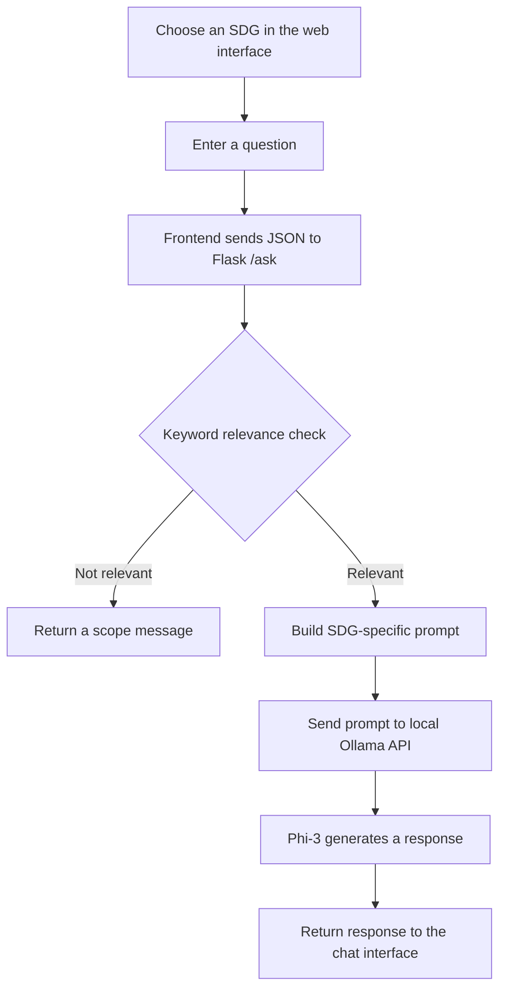

# Sustaina AI 🌱
### An SDG-focused chatbot powered by Flask and a locally hosted language model

Sustaina AI is a web-based chatbot designed around the **17 United Nations Sustainable Development Goals (SDGs)**. Choose a goal, ask a related question, and receive a response generated by a locally running **Phi-3 model through Ollama**.

The project combines a lightweight web interface, a Flask API, SDG-specific prompts, and a keyword-based relevance check to help keep conversations aligned with the selected goal.

<p align="center">
  
</p>

<p align="center">
  
</p>

---

## ✨ Features

- **17 SDG-focused modes** — select a Sustainable Development Goal to set the topic for the conversation.
- **Goal-specific prompts** — each SDG has a corresponding prompt that guides the model's responses.
- **Keyword-based relevance check** — a lightweight check evaluates whether a question appears related to the selected SDG.
- **Local language-model inference** — sends prompts to Ollama running on your machine.
- **Web-based chat interface** — HTML, CSS, and JavaScript frontend connected to a Flask backend.
- **No external LLM API key required** — inference is sent to the local Ollama service.

> **Note:** The relevance check is a keyword-based heuristic, not a comprehensive semantic classifier or a security boundary. It may accept unrelated questions or reject relevant ones.

## 🧭 How it works



## 🛠️ Tech stack

| Layer | Technologies |
|---|---|
| Frontend | HTML, CSS, JavaScript |
| Backend | Python, Flask |
| Language model runtime | Ollama |
| Model configured in the application | `phi3:3.8b-mini-128k-instruct-q4_K_M` |
| HTTP requests | Python `requests` |

## 🚀 Run locally

### Prerequisites

- Python 3.9+ (or a compatible Python version)
- [Ollama](https://ollama.com/) installed and running
- Enough memory and disk space for the configured Phi-3 model

### 1. Clone the repository

```bash
git clone https://github.com/YashK-2006/sustaina-ai.git
cd sustaina-ai
```

### 2. Create and activate a virtual environment

**Windows (PowerShell):**

```powershell
python -m venv .venv
.\.venv\Scripts\Activate.ps1
```

**macOS / Linux:**

```bash
python3 -m venv .venv
source .venv/bin/activate
```

### 3. Install Python dependencies

```bash
python -m pip install -r requirements.txt
```

### 4. Start Ollama and make the configured model available

Start the Ollama application or run `ollama serve` in a separate terminal if the service is not already running. Then make sure the model tag configured in `app.py` is installed:

```bash
ollama pull phi3:3.8b-mini-128k-instruct-q4_K_M
```

If Ollama reports that this tag is unavailable in your environment, check the model tag available to your Ollama installation and update the `model` value in `app.py` to match an installed model.

### 5. Start the Flask application

From the repository root, with your virtual environment activated:

```bash
python app.py
```

The application is configured to listen on port **8080**. Open:

- Main page: [http://127.0.0.1:8080/index.html](http://127.0.0.1:8080/index.html)
- Chat page: [http://127.0.0.1:8080/chatbot.html](http://127.0.0.1:8080/chatbot.html)

Keep the Ollama service running while using the chatbot.

## 📁 Project files

| File | Purpose |
|---|---|
| `app.py` | Flask routes, SDG prompts, relevance check, and Ollama API request |
| `index.html` | Main web page |
| `chatbot.html` | Chat interface page |
| `script.js` | Frontend JavaScript for the main page |
| `chatbot.js` | Chat interface JavaScript |
| `styles.css` | Frontend styling |
| `requirements.txt` | Python dependencies |
| `run_chatbot.bat` | Windows launcher script |
| `LICENSE` | MIT license |

## 🔐 Privacy and limitations

- Prompts are sent to the **local Ollama endpoint** configured in `app.py`; the application does not require a third-party LLM API key.
- Local inference does not automatically guarantee complete privacy across every part of a system. Review your own environment and any services you connect.
- Responses are generated by an AI model and may be inaccurate. Verify important information with reliable sources.
- The SDG relevance filter relies on keyword matching and should be treated as a basic prototype feature, not a guarantee that every response stays within scope.

## 🌍 About the Sustainable Development Goals

The 17 SDGs are a set of global goals adopted by the United Nations to address social, economic, and environmental challenges.

Learn more: [United Nations Sustainable Development Goals](https://sdgs.un.org/goals).

## 📄 License

This project is distributed under the [MIT License](LICENSE).

---

<p align="center">
  Built to explore how locally hosted AI can make sustainability-focused information easier to access. 🌱
</p>
