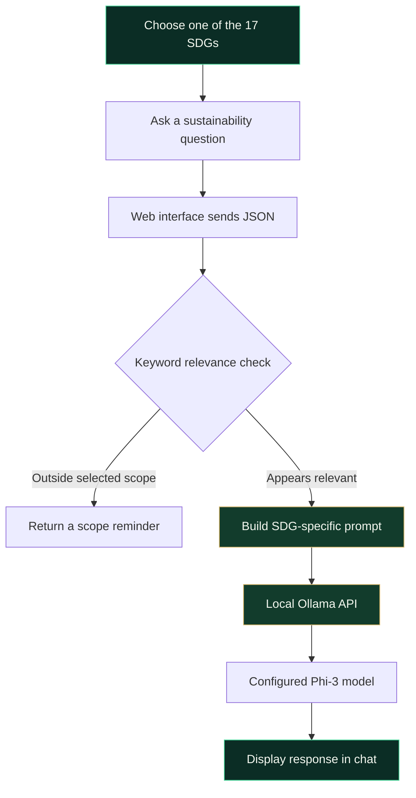

<div align="center">



<br />


<br />

[](https://www.python.org/)
[](https://flask.palletsprojects.com/)
[](https://ollama.com/)
[](https://sdgs.un.org/goals)
[](LICENSE)

<br />

<a href="https://github.com/YashK-2006/sustaina-ai">
  
</a>
<a href="https://github.com/YashK-2006/sustaina-ai/issues">
  
</a>

<br />

<sub>INTELLIGENCE WITH PURPOSE · LOCAL AI · GLOBAL GOALS</sub>

</div>

---

## ✦ The vision

**Sustaina AI** is a web-based, SDG-focused chatbot built around the **17 United Nations Sustainable Development Goals**. Choose a goal, ask a related question, and receive a response from a locally hosted Phi-3 model through Ollama.

The experience brings together a lightweight web interface, a Flask API, goal-specific prompts, and a keyword-based relevance check—so sustainability exploration starts with a clear focus.

> **The philosophy:** make sustainability easier to explore, one thoughtful question at a time.

## ◈ Explore the experience

<table>
<tr>
<td width="50%" valign="top">

### 🌍 Seventeen paths
Choose from all 17 Sustainable Development Goals, from No Poverty and Quality Education to Climate Action and Partnerships.

### ✧ Goal-aware prompts
Each selected goal supplies a corresponding prompt to guide the local model's response.

</td>
<td width="50%" valign="top">

### 🌿 Local-first inference
Prompts are sent to the Ollama service running in your environment. No third-party LLM API key is required by this project.

### ◌ Focus check
A lightweight keyword heuristic checks whether a question appears related to the selected SDG.

</td>
</tr>
</table>

## ✧ A look inside

<p align="center">
  
</p>

<p align="center">
  
</p>

## ⟡ How it works



## ⚙ Technology

| Layer | Technology |
|---|---|
| Interface | HTML, CSS, JavaScript |
| Backend | Python, Flask |
| Local model runtime | Ollama |
| Configured model | `phi3:3.8b-mini-128k-instruct-q4_K_M` |
| HTTP client | Python `requests` |
| Interaction | JSON request to Flask `/ask` endpoint |

## ✦ Run locally

### Requirements

- Python 3.9 or a compatible version
- [Ollama](https://ollama.com/) installed and running
- Enough memory and disk space for the configured Phi-3 model

### 1. Clone the repository

```bash
git clone https://github.com/YashK-2006/sustaina-ai.git
cd sustaina-ai
```

### 2. Create a virtual environment

**macOS / Linux**

```bash
python3 -m venv .venv
source .venv/bin/activate
```

**Windows PowerShell**

```powershell
python -m venv .venv
.\.venv\Scripts\Activate.ps1
```

### 3. Install dependencies

```bash
python -m pip install --upgrade pip
python -m pip install -r requirements.txt
```

### 4. Start Ollama and pull the configured model

Make sure Ollama is running, then run:

```bash
ollama pull phi3:3.8b-mini-128k-instruct-q4_K_M
```

If the tag is unavailable in your Ollama environment, check the model tag available to your installation and update the `model` value in `app.py` to match an installed model.

### 5. Start Sustaina AI

```bash
python app.py
```

Open the local application:

- Home: [http://127.0.0.1:8080/index.html](http://127.0.0.1:8080/index.html)
- Conversation studio: [http://127.0.0.1:8080/chatbot.html](http://127.0.0.1:8080/chatbot.html)

Keep the Ollama service running while chatting. The frontend assets are served from the `static/` directory.

## ◈ Project files

| Path | Responsibility |
|---|---|
| `app.py` | Flask routes, SDG prompts, relevance check, and Ollama request |
| `index.html` | Animated landing page and 17-goal selector |
| `chatbot.html` | Conversation studio |
| `styles.css` | Source stylesheet for the royal theme |
| `chatbot.js` | Chat logic and persisted appearance toggle |
| `static/styles.css` | Served stylesheet, animation system, responsive layout |
| `static/chatbot.js` | Served chat logic |
| `static/sustaina-hero.svg` | Animated sustainability hero artwork |
| `requirements.txt` | Python dependencies |
| `run_chatbot.bat` | Windows launcher |
| `LICENSE` | MIT License |

## 🔐 Privacy and limitations

- Prompts are sent to the local Ollama endpoint configured in `app.py`; the project does not require a third-party LLM API key.
- Local inference does not guarantee privacy across every part of your device or environment. Review any services you connect.
- AI-generated responses can be inaccurate. Verify important information with reliable sources.
- The SDG relevance check is a **keyword-based heuristic**, not a semantic classifier or security boundary. It may accept unrelated questions or reject relevant ones.
- The animated interface respects the browser's reduced-motion preference.

## 🌎 The 17 Sustainable Development Goals

The SDGs are a set of global goals adopted by the United Nations to address social, economic, and environmental challenges.

[Explore the official UN Sustainable Development Goals →](https://sdgs.un.org/goals)

## License

Distributed under the [MIT License](LICENSE).

---

<div align="center">

**Sustaina AI** · A little more curiosity. A little more possibility.

<sub>BUILT TO EXPLORE HOW LOCAL AI CAN MAKE SUSTAINABILITY-FOCUSED INFORMATION EASIER TO ACCESS 🌱</sub>

</div>
